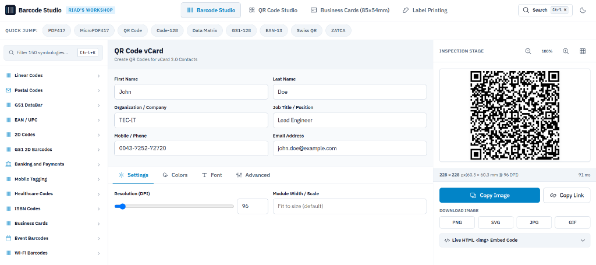
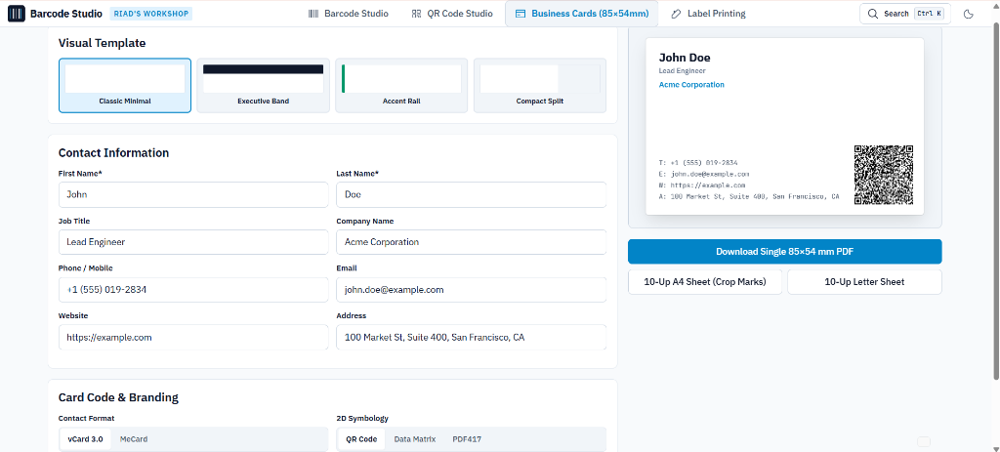
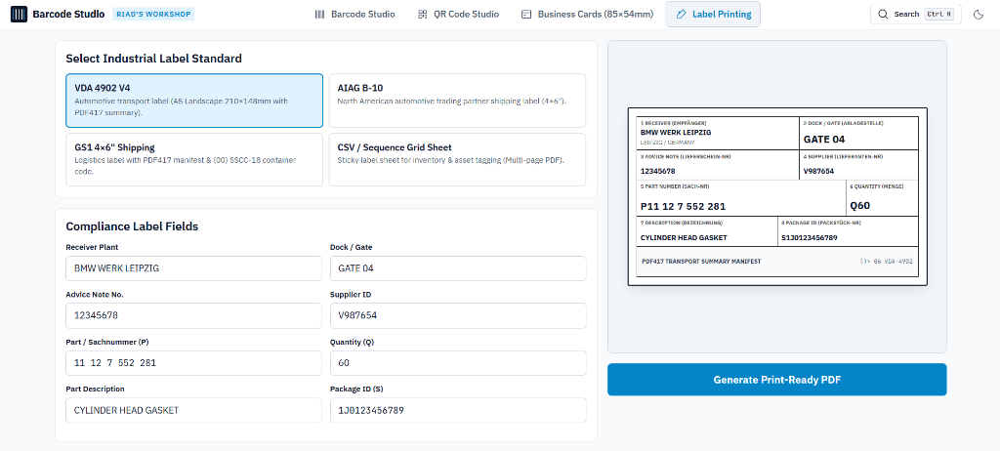

# Barcode Studio

A local, full-featured **Barcode, QR Code, and PDF417 Studio Suite** built with Node.js, Express 5, `bwip-js`, and `pdf-lib`.

## Screenshots

### Barcode Studio (150 Symbologies & Inspection Stage)


### Business Cards (85×54 mm Vector PDF & 10-Up Crop-Mark Sheets)


### Label Printing Templates (VDA 4902 V4, AIAG B-10, GS1 4×6", CSV Grid)


## Features

### 1. Barcode Generator (13 Categories / 150 Entries)
- **Default Landing Symbology:** Opens on **PDF417** with quick-jump pills (`PDF417`, `MicroPDF417`, `QR Code`, `Code-128`, `Data Matrix`, `GS1-128`, `EAN-13`, `Swiss QR`, `ZATCA`) and `Ctrl+K` instant search.
- **Full Symbology Coverage:**
  - **Linear Codes (12):** Code-128, Code-11, Code-2of5 Interleaved (ITF), Code-39, Code-39 Full ASCII, Code-93, Flattermarken, GS1-128, MSI, Pharmacode One-Track / Two-Track, Telepen Alpha.
  - **Postal Codes (15):** Australian Post, DAFT, DPD Parcel, Japanese Postal, KIX, Korean Postal Authority Code, Planet Code 12, Royal Mail 4-State, Royal Mail Mailmark 4-State & 2D, USPS PostNet 5/9/11, USPS IM Package, UPU S10.
  - **GS1 DataBar & Composites (13):** Omni, Stacked, Stacked Omni, Limited, Expanded, Expanded Stacked, plus all Composite (`CCA`) variants.
  - **EAN / UPC (9) & ISBN Codes (5):** EAN-8, EAN-13, EAN-14, UPC-A, UPC-E (with Composites), ISBN-13 (+5), ISMN, ISSN (+2).
  - **2D & GS1 2D Codes (18):** PDF417, MicroPDF417, QR Code (Latin-1 & UTF-8), Micro QR, Data Matrix (46 square & rectangular sizes), Aztec, Codablock-F, MaxiCode, Han Xin, DotCode, NTIN, PPN, GS1 QR Code, GS1 DataMatrix, and GS1 Digital Link.
  - **Banking & Payments (9):** EPC QR Code V2 (SEPA), Swiss QR Code v2.3 / v2.2 / v1.0 (`NON`, `SCOR`, `QRR` with QR-IBAN & Mod-10 validation), and ZATCA QR Code (TLV Base64).
  - **Healthcare (24), Mobile Tagging (37), Business Cards (4), Events (2), Wi-Fi (2):** Full structured forms and payload builders (`vCard 3.0`, `MeCard`, `VEVENT`, `WIFI`).
- **PDF417 Advanced Controls:** Configure `Columns` (1–30), `Rows` (3–90), `Error Correction Level` (0–8), `Compact / Truncated` mode, and `Row Height Multiplier` (1–6).
- **Batch & Sequence Tools:** Sequence generator (`Prefix`, `Suffix`, `Start`, `End`, `Increment`, and `$`/`#`/`*` masks), escape sequence translation (`\F`, `\t`, `\n`, `\r`, `\xHH`), and unlimited multi-row `.zip` batch downloads.
- **Settings & Formats:** `PNG`, `SVG`, `JPG`, and `GIF` exports, `72–600 DPI`, module width units (`Fit`, `Minimal`, `mm`, `mils`, `px`), `0°/90°/180°/270°` rotation, 24 Code Pages, 15 font options, custom colors, quiet zone controls, and live HTML `` embed snippets.

### 2. Companion Tools
- **QR Code Studio:** Dedicated quick QR builder (`Plain Text`, `URL`, `Phone`, `SMS`, `Email`, `Wi-Fi`, `Event`, `vCard`, `MeCard`, `EPC SEPA`) with size presets (up to 800 px), error correction (`L/M/Q/H`), transparent PNG toggle, and instant PNG/SVG/JPG downloads.
- **Business Cards (85×54 mm PDF):** Contact form, optional logo upload, `vCard`/`MeCard` and `QR Code`/`Data Matrix`/`PDF417` selection, 4 card templates, and vector PDF export (single 85×54 mm card or 10-up A4 / US Letter sheets with crop marks).
- **Label Printing Templates:** Live preview and vector PDF export for **VDA 4902 V4**, **AIAG B-10**, **GS1 4×6" Shipping Labels**, and **CSV / Sequence Grid Sheets** (multi-page A4 / US Letter).

### 3. UI & Accessibility
- Dual-theme interface (**Light Studio Paper** and **Dark OLED IDE**) with an isolated optical barcode stage, inline SVG icons, keyboard navigation, and responsive mobile accordion layout.

## Getting Started

```bash
npm install
npm start
```

Open `http://localhost:3000` in your browser (or bookmarkable routes such as `/en/pdf417`, `/en/qrcode`, `/en/code128`, `/qr-studio`, `/business-cards`, `/labels`).

## Running Tests

```bash
npm test
```

- `npm test` executes the full Node test suite (`tests/*.test.js`).
- `node tests/live_browser_tour.mjs` runs the end-to-end headless Chrome CDP verification tour.

## HTTP API Endpoints

- `GET` / `POST /barcode.ashx` — TEC-IT-compatible endpoint supporting `code`, `data`, `imagetype` (`Png`, `Svg`, `Jpg`, `Gif`), `dpi`, `base64=true`, `multiplebarcodes=true` (ZIP), and `onerror` (`OnErrorDisplay`, `OnErrorIgnore`, `OnError500`, `OnError204`).
- `GET /api/catalog` & `GET /api/symbologies` — Symbology catalog and configuration metadata.
- `POST /api/sequence` — Sequence expansion endpoint.
- `GET` / `POST /api/batch` — Multi-row ZIP archive export.
- `GET` / `POST /api/pdf/business-card` — 85×54 mm Business Card PDF export.
- `GET` / `POST /api/pdf/label` — Compliance & CSV Grid Label PDF export.
